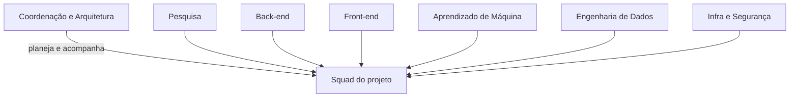

# Áreas de especialidade

Cada membro do NARA tem **uma área principal de especialidade**. Nos projetos, a pessoa responde pelas entregas dessa área e aprofunda o estudo nela.

- Cada área tem uma **referência técnica**, que revisa o trabalho da área e orienta quem está começando.
- Os projetos continuam sendo feitos em equipe: cada projeto monta um **squad** com pessoas de várias áreas.
- O nivelamento é organizado por área, com uma trilha de estudo própria para cada uma.
- A divisão é revista **a cada semestre**. É nesse momento que um membro pode pedir troca de área.

## As 7 áreas

| Área | Responsabilidades | Entregas típicas | Tecnologias |
|---|---|---|---|
| **Coordenação e Arquitetura** | Organização do grupo, levantamento da infraestrutura e das tecnologias de cada projeto, priorização das tarefas | Documento de arquitetura, quadro no GitHub Projects, padrões do handbook | GitHub Projects, MkDocs, Coolify |
| **Pesquisa e Análise** | Pesquisas temáticas (feminicídio, mercado de trabalho, analfabetismo), protocolo de pesquisa, escrita científica | Relatórios, artigos, apresentações em eventos | Python, pandas, Jupyter, estatística |
| **Back-end** | APIs, regras de negócio, segurança das rotas, testes | APIs documentadas e testadas | Java 21, Spring Boot, PostgreSQL |
| **Front-end** | Interfaces, visualização de dados, acessibilidade | Telas, mapas e painéis | Next.js, React, TypeScript, Tailwind |
| **Aprendizado de Máquina** | Modelos de predição e de agrupamento, agentes de IA, avaliação dos modelos | Modelos treinados, APIs de predição | Python, scikit-learn, FastAPI |
| **Engenharia de Dados** | Coleta, limpeza e carga dos dados, modelagem do banco | Pipelines ETL, bases atualizadas | Python, SQLAlchemy, PostgreSQL |
| **Infraestrutura e Segurança** | Deploy, CI/CD, monitoramento, cibersegurança | Serviços no ar, workflows de CI, revisões de segurança | Docker, GitHub Actions, Coolify, VPS |

### Vagas por área

O laboratório tem 13 membros, distribuídos assim:

| Área | Vagas |
|---|---|
| Coordenação e Arquitetura | 1 |
| Pesquisa e Análise | 3 |
| Back-end | 2 |
| Front-end | 2 |
| Aprendizado de Máquina | 2 |
| Engenharia de Dados | 2 |
| Infraestrutura e Segurança | 1 |

A área de cada pessoa aparece na página [Membros](membros.md).

## Squads e regras

Cada projeto recebe uma pessoa de cada área de que precisa, e a Coordenação acompanha todos os squads.

- **Área principal:** cada membro tem uma só área principal, e é nela que faz a maior parte das suas tarefas.
- **Área secundária:** é opcional e serve para cobrir ausências ou picos de trabalho em outra área.
- **Referência técnica:** revisa os pull requests e as entregas da área e orienta os membros novos.
- **Só as áreas necessárias:** o squad recebe apenas as áreas que o projeto exige. Uma pesquisa, por exemplo, pode não ter front-end.
- **Revisão semestral:** no início de cada semestre, a divisão é revista e as trocas de área são decididas.

## Roadmap de cada área

A trilha de cada área tem 4 níveis:

- os níveis 1 e 2 são o nivelamento de quem entra na área;
- o nível 3 é a primeira entrega num projeto do NARA;
- o nível 4 prepara a pessoa para ser referência técnica.

| Área | Nível 1: Fundamentos | Nível 2: Ferramentas da área | Nível 3: Entrega em projeto | Nível 4: Referência |
|---|---|---|---|---|
| **Coordenação e Arquitetura** | Git, GitHub Flow e GitHub Projects | Diagramas de arquitetura e de sequência, escolha de stack | Documento de arquitetura de um projeto | Revisão da arquitetura dos squads, padrões do handbook |
| **Pesquisa e Análise** | Estatística descritiva, Python e pandas | Fontes públicas de dados e protocolo de pesquisa | Estudo temático (feminicídio, mercado de trabalho) | Artigo ou apresentação em evento |
| **Back-end** | Java 21 e orientação a objetos | Spring Boot: Controller, Service, Repository e REST | PostgreSQL, validação, tratamento de erros e testes com MockMvc | Spring Security, cache, limite de requisições e OpenAPI |
| **Front-end** | HTML, CSS e JavaScript | React e TypeScript | Next.js App Router consumindo uma API | Visualização de dados, acessibilidade e testes com Playwright |
| **Aprendizado de Máquina** | Python, NumPy e pandas | Modelos supervisionados e de agrupamento com scikit-learn | Avaliação e validação de um modelo | Modelo servido por FastAPI, agentes de IA |
| **Engenharia de Dados** | SQL e modelagem relacional | PostgreSQL: chaves, índices e consultas | Pipeline ETL com pandas e SQLAlchemy | Carga sem interrupção, agendamento e qualidade dos dados |
| **Infraestrutura e Segurança** | Linux, terminal e redes | Docker e Docker Compose | CI com GitHub Actions e deploy no Coolify | OWASP Top 10, gestão de segredos e monitoramento |

## Fichas das áreas

Cada ficha diz o que faz quem é selecionado para a área, o que precisa estudar e como ajuda nos projetos.

### Coordenação e Arquitetura

- **O que faz:** organiza o grupo, define com cada squad as tecnologias e como as partes se comunicam, e mantém o GitHub Projects e o handbook.
- **O que estuda:**
    - Git, GitHub Flow e GitHub Projects;
    - diagramas de arquitetura e de sequência;
    - critérios de escolha de stack;
    - revisão de arquitetura.
- **Como ajuda no projeto:** escreve o documento de arquitetura de cada projeto, define o contrato entre front-end, back-end e serviços de dados, e decide a ordem das entregas.
- **No GitHub:** time `coordenacao`, etiqueta `área: coordenação`.

### Pesquisa e Análise

- **O que faz:** conduz os estudos temáticos (feminicídio, mercado de trabalho, analfabetismo), do levantamento das fontes ao relatório.
- **O que estuda:**
    - estatística descritiva, Python e pandas;
    - fontes públicas de dados e o [protocolo de pesquisa](../pesquisa/protocolo.md);
    - escrita científica.
- **Como ajuda no projeto:** define as perguntas e os indicadores que os sistemas mostram, confere os números e escreve artigos e apresentações.
- **No GitHub:** time `pesquisa`, etiqueta `área: pesquisa`.

### Back-end

- **O que faz:** desenvolve as APIs em Spring Boot, com regras de negócio, segurança das rotas e testes.
- **O que estuda:**
    - Java 21 e orientação a objetos;
    - Spring Boot (Controller, Service, Repository, REST);
    - PostgreSQL, validação, tratamento de erros e MockMvc;
    - Spring Security, cache e OpenAPI.
- **Como ajuda no projeto:** constrói e mantém as APIs Spring Boot dos projetos, como a API do Mapa Social, com testes e documentação OpenAPI.
- **No GitHub:** time `backend`, etiqueta `área: back-end`.

### Front-end

- **O que faz:** desenvolve as telas, os mapas e os painéis em Next.js.
- **O que estuda:**
    - HTML, CSS e JavaScript;
    - React e TypeScript;
    - Next.js App Router consumindo uma API;
    - visualização de dados, acessibilidade e Playwright.
- **Como ajuda no projeto:** constrói as telas dos projetos, como os mapas e painéis do Mapa Social, consumindo as APIs do back-end.
- **No GitHub:** time `frontend`, etiqueta `área: front-end`.

### Aprendizado de Máquina

- **O que faz:** cria modelos de predição e de agrupamento e agentes de IA.
- **O que estuda:**
    - Python, NumPy e pandas;
    - scikit-learn;
    - avaliação e validação de modelos;
    - FastAPI para servir modelos.
- **Como ajuda no projeto:** mantém os modelos do VizuData e a API Python do Mapa Social.
- **No GitHub:** time `machine-learning`, etiqueta `área: aprendizado de máquina`.

### Engenharia de Dados

- **O que faz:** coleta, limpa e carrega os dados e modela os bancos.
- **O que estuda:**
    - SQL e modelagem relacional;
    - PostgreSQL (chaves, índices, consultas);
    - pipelines ETL com pandas e SQLAlchemy;
    - carga sem interrupção e agendamento.
- **Como ajuda no projeto:** mantém o pipeline do Mapa Social e modela os bancos PostgreSQL dos projetos.
- **No GitHub:** time `engenharia-de-dados`, etiqueta `área: engenharia de dados`.

### Infraestrutura e Segurança

- **O que faz:** cuida do deploy, da CI, do monitoramento e das revisões de segurança.
- **O que estuda:**
    - Linux, terminal e redes;
    - Docker e Docker Compose;
    - GitHub Actions e Coolify;
    - OWASP Top 10, gestão de segredos e monitoramento.
- **Como ajuda no projeto:** monta a CI, os Dockerfiles e o deploy dos projetos no Coolify, e revisa a segurança de todos eles.
- **No GitHub:** time `infra-seguranca`, etiqueta `área: infra e segurança`.

## Segmentação no GitHub

As áreas são registradas na organização GRUPO-NARA com quatro recursos. Os times só podem ser criados por um owner da organização e só valem para os repositórios dela.

| Recurso | Para que serve | Como configurar |
|---|---|---|
| **Times da organização** | Um time por área, com os membros e com a referência técnica como maintainer | GRUPO-NARA → Teams → New team, com os 7 nomes das fichas |
| **CODEOWNERS** | Pede automaticamente a revisão do time da área quando um pull request mexe nas pastas dela | Arquivo `.github/CODEOWNERS` em cada repositório, por exemplo `/backend/ @GRUPO-NARA/backend` |
| **Etiquetas** | Marcam cada issue com a área responsável | As 7 etiquetas `área: …` das fichas, criadas em cada repositório |
| **Campo "Área" no GitHub Projects** | Filtra o quadro por área e mostra a carga de cada uma | Campo de seleção única "Área" com as 7 opções (veja [Processo e rituais](processo.md#campos-do-projeto)) |
