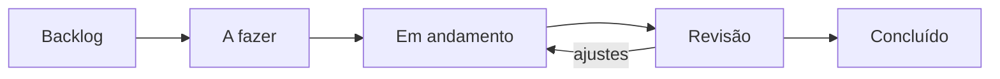

# Processo e rituais

Todo trabalho do NARA, de software ou de pesquisa, vira **issue** e entra no projeto **[NARA — Roadmap]({{ lab.links.roadmap }})**.

## Fluxo de uma tarefa



| Status | Significa |
|---|---|
| **Backlog** | Ideia registrada, ainda sem prioridade |
| **A fazer** | Priorizada, com responsável e data alvo |
| **Em andamento** | Alguém está trabalhando nela agora |
| **Revisão** | PR aberto ou entrega aguardando revisão |
| **Concluído** | PR mergeado ou entrega aprovada |

### Regras

- **Máximo de 2 issues "Em andamento" por pessoa.** Terminar antes de começar outra.
- Issue em **A fazer** precisa ter responsável, Projeto, Área, Prioridade e Data alvo.
- Travou por algo externo? Coloque a label `bloqueado` e comente o motivo.
- Precisa de apoio? Use a label `precisa de ajuda`. Na revisão semanal, alguém assume.

### Quando uma tarefa está concluída

- [ ] Critérios de aceite da issue cumpridos
- [ ] PR revisado e aprovado por outra pessoa
- [ ] Sem senha, token ou `.env` no código
- [ ] Documentação atualizada, se a mudança afeta outras pessoas

## Campos do projeto

| Campo | Para que serve |
|---|---|
| **Status** | Coluna do Kanban |
| **Projeto** | Qual projeto ou pesquisa (as opções vêm de `data/`) |
| **Tipo** | Software, Pesquisa ou Gestão |
| **Área** | Front-end, Back-end, Dados/ETL, Infra, Docs, Pesquisa |
| **Prioridade** | Alta, Média, Baixa |
| **Etapa da pesquisa** | Só para issues de pesquisa |
| **Iteração** | Sprint de 2 semanas |
| **Início** e **Data alvo** | Alimentam a visão de linha do tempo |
| **Estimativa** | Tamanho em pontos (1, 2, 3, 5, 8) |

## Visões

| Visão | Layout | Configuração | Responde |
|---|---|---|---|
| **Kanban** | Board | Colunas por Status | O que está acontecendo agora? |
| **Roadmap** | Roadmap | Datas: Início → Data alvo, agrupado por Projeto | O que entrega quando? |
| **Por pessoa** | Tabela | Agrupado por Assignees, filtro `-status:Concluído` | Quem está com o quê? |
| **Sprint atual** | Board | Filtro `iteração:@current` | O que fecha nesta sprint? |
| **Pesquisa** | Board | Filtro `tipo:Pesquisa`, colunas por Etapa da pesquisa | Em que fase está cada pesquisa? |

## Prazos

Entregas com data externa (relatórios FAPEMA, entregas ao MPMA, submissão de artigo) viram **Milestones** no repositório do projeto, com data. As issues necessárias para a entrega ficam ligadas à milestone, e a barra de progresso mostra quanto falta.

## Código

- **Branches:** `tipo/descricao-curta`, por exemplo `feat/filtro-por-ano` ou `fix/rodape-educacao`.
- **Commits:** [Conventional Commits](https://www.conventionalcommits.org/pt-br/), por exemplo `feat: adiciona filtro por ano`.
- **PRs:** nada entra na `main` sem PR aprovado por outra pessoa. A descrição do PR usa `Fecha #123` para fechar a issue automaticamente.

## Rituais

| Ritual | Frequência | Duração | Pauta |
|---|---|---|---|
| Revisão do board | Semanal | 30 min | Bloqueios, pedidos de ajuda, o que entra na semana |
| Revisão de roadmap | Mensal | 1 h | Prazos, milestones, prioridades |
| Planejamento de semestre | Início de semestre | 2 h | Projetos e pesquisas do semestre, abertura de turma de nivelamento |

---

## Configuração inicial (feita uma vez)

??? note "Passo a passo para a coordenação"

    **1. Rodar o script** (cria labels, projeto e campos):

    ```bash
    gh auth login
    gh auth refresh -s project,read:org
    python scripts/configurar_github.py --simular   # confere antes
    python scripts/configurar_github.py
    ```

    **2. Ajustar o Status** — no projeto, clique no menu do campo **Status** → *Edit field*. Renomeie e crie as opções para: Backlog, A fazer, Em andamento, Revisão, Concluído.

    **3. Criar a Iteração** — *Settings* do projeto → *New field* → tipo **Iteration**, nome "Iteração", duração de 2 semanas.

    **4. Criar as visões** da tabela acima: aba **+ New view**, escolha o layout e configure agrupamento e filtro. Renomeie cada aba.

    **5. Automações** — *Settings* → *Workflows*: ative **Item closed → Concluído** e **Pull request merged → Concluído**.

    **6. Issue templates** — os templates ficam em `templates-organizacao/.github/` neste repositório. Para publicá-los no `GRUPO-NARA/.github`:

    ```bash
    bash scripts/publicar_templates.sh
    ```

    Eles valem para todos os repositórios que não tenham templates próprios. Para mudar um template, edite o arquivo aqui e rode o script de novo.
