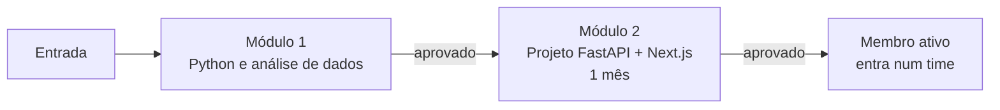

# Nivelamento

O nivelamento é a porta de entrada do NARA. São **dois módulos**: primeiro a base de Python e análise de dados, depois um projeto completo com dados reais.

| Módulo | Conteúdo | Prazo | Como é aprovado |
|---|---|---|---|
| [**Módulo 1**](modulo-1.md) | Python do básico à POO, NumPy, Pandas, tratamento de dados e Streamlit | No seu ritmo | Ver [critério do módulo 1](modulo-1.md#criterio-de-aprovacao) |
| [**Módulo 2**](modulo-2.md) | Projeto de análise de dados com backend FastAPI e frontend Next.js | **1 mês** após a aprovação no módulo 1 | Código no GitHub, documentação clara e apresentação |

## Como funciona o acompanhamento

1. Quando você entra, a coordenação abre uma **issue de nivelamento** com o seu nome no repositório `nara-handbook`, usando o template **Nivelamento**.
2. Um membro veterano é definido como seu **padrinho/madrinha**. É a pessoa a quem você recorre primeiro.
3. Você marca os itens da checklist na própria issue conforme avança. A coordenação acompanha pelo board do projeto **NARA — Roadmap**.

## Dúvidas

Você pode estudar em casa, mas **o ideal é ir ao laboratório (LEA) tirar dúvidas com o pessoal**. Aprender junto é mais rápido e é assim que você conhece a equipe com quem vai trabalhar.

Também pode comentar na sua issue de nivelamento: o padrinho recebe a notificação.

## Depois do nivelamento

Aprovado no módulo 2, você:

- passa a ter status `ativo` em `data/membros.yml`;
- entra num time e recebe uma primeira issue com a label `good first issue` num projeto real.
