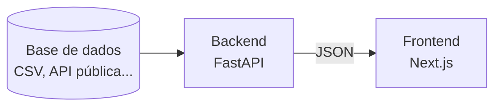

# Módulo 2 — Projeto de análise de dados

Um projeto completo, do dado à tela, com a mesma arquitetura dos projetos reais do laboratório.

- **Prazo:** **1 mês**, contado a partir da aprovação no módulo 1
- **Base de dados:** escolha livre, mas **dê preferência a dados do Maranhão**

## Arquitetura obrigatória



| Camada | Tecnologia | Responsabilidade |
|---|---|---|
| **Backend** | FastAPI | Processar os dados e fornecê-los por meio de uma API |
| **Frontend** | Next.js | Interface visual que consome o backend e exibe os dados |

## Onde encontrar dados do Maranhão

São as mesmas fontes que o laboratório usa no Mapa Social:

| Fonte | O que tem |
|---|---|
| [IMESC](https://imesc.ma.gov.br/) | Indicadores socioeconômicos do Maranhão |
| [IBGE — SIDRA](https://sidra.ibge.gov.br/) | Censo, população, PIB municipal e muito mais |
| [IPEADATA](http://www.ipeadata.gov.br/) | Séries históricas sociais e econômicas por município |
| [DataSUS](https://datasus.saude.gov.br/) | Saúde: estabelecimentos, nascimentos, mortalidade |

## Critério de aprovação

- [ ] **Código completo no GitHub**, em repositório público
- [ ] **Documentação clara no README**, explicando o projeto e como rodar a aplicação
- [ ] **Apresentação do projeto** para o laboratório

### O que o README precisa ter

Use esta estrutura como ponto de partida:

````markdown
# Nome do projeto

Uma ou duas frases sobre o que o projeto mostra.

## Dados
- Fonte: nome e link
- Período e recorte (ex.: municípios do MA, 2010–2022)

## Arquitetura
- Backend: FastAPI — o que ele processa e quais endpoints expõe
- Frontend: Next.js — quais telas e gráficos existem

## Como rodar

### Backend
```bash
cd backend
python -m venv .venv && source .venv/bin/activate
pip install -r requirements.txt
uvicorn main:app --reload
```

### Frontend
```bash
cd frontend
npm install
npm run dev
```

## Endpoints
| Método | Rota | Descrição |
|---|---|---|
| GET | /indicadores | ... |

## Autor
Seu nome — GitHub
````

Uma estrutura de pastas que funciona bem:

```
meu-projeto/
├── backend/
│   ├── main.py
│   ├── requirements.txt
│   └── dados/
├── frontend/
│   ├── package.json
│   └── app/
└── README.md
```

## Dicas

- **Comece pelo dado.** Explore a base num notebook antes de escrever a API.
- **Faça o backend funcionar sozinho** antes do frontend. O FastAPI gera documentação automática em `/docs`, ótima para testar.
- **Commits pequenos e frequentes**, seguindo [Conventional Commits](../laboratorio/processo.md#codigo).
- Travou? Vá ao laboratório ou comente na sua issue de nivelamento. Pedir ajuda cedo economiza dias.
