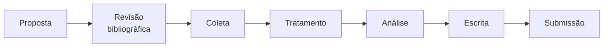

# Protocolo de pesquisa

Como uma pesquisa do NARA nasce, anda e termina. Vale para todas, do tema mais simples ao mais sensível.

## 1. Proposta

Antes de criar qualquer coisa, a ideia é apresentada na **revisão mensal** de roadmap com:

- a pergunta de pesquisa, em uma frase;
- as fontes de dados que parecem existir;
- quem vai participar;
- um(a) **orientador(a)** que aceitou acompanhar.

Aprovada, a pesquisa entra em `data/pesquisas.yml` com `status: planejada`.

## 2. Repositório

Toda pesquisa tem repositório próprio, criado a partir do [**template-pesquisa**](https://github.com/GRUPO-NARA/template-pesquisa):

1. No template, clique em **Use this template → Create a new repository**.
2. Owner: `GRUPO-NARA`. Nome: `pesquisa-<tema>-ma`, por exemplo `pesquisa-feminicidio-ma`.
3. Preencha o `README.md` e o `metodologia.md`.
4. Atualize o campo `repositorio` da pesquisa em `data/pesquisas.yml`.

O template já traz:

| Pasta | Para quê |
|---|---|
| `metodologia.md` | Fontes, recorte, definições, limitações e ética |
| `data/raw/` | Dados originais, nunca editados à mão |
| `data/processed/` | Dados tratados pelo código |
| `notebooks/` | Exploração numerada na ordem de execução |
| `src/` | Código reutilizável, incluindo a padronização de municípios do MA |
| `dashboard/` | App Streamlit que lê `data/processed/` |
| `artigo/` | Texto e figuras |

## 3. Acompanhamento

- Cada entrega vira uma issue com o template **Atividade de pesquisa**, no repositório da pesquisa.
- No projeto **NARA — Roadmap**, a issue recebe *Tipo: Pesquisa* e a **Etapa da pesquisa**. A visão **Pesquisa** mostra todas por etapa.
- Prazos externos (submissão a evento, relatório de bolsa) viram **Milestones** no repositório.
- Mudou de etapa? Atualize o campo `etapa` em `data/pesquisas.yml`.

## 4. Regras de dados

- **`data/raw/` é intocável.** Toda transformação está no código, e qualquer pessoa consegue refazer `data/processed/` do zero.
- **Toda fonte é documentada:** nome, link, tabela e data de acesso, em `metodologia.md` e em `data/raw/README.md`.
- **Mudanças na fonte entram como limitação.** Por exemplo: definição de um indicador que mudou, anos faltantes ou municípios criados depois do início da série.
- **Arquivos acima de ~50 MB não vão para o GitHub.** Versione o script que baixa o arquivo.

## 5. Ética e privacidade

!!! danger "Regra inegociável"
    Usamos **somente dados públicos e agregados**. Nenhum resultado, tabela ou gráfico pode permitir identificar uma pessoa.

- **Contagens baixas:** em municípios pequenos, poucos casos podem identificar alguém. Agregue por região (por exemplo, as regiões de planejamento do IMESC) ou suprima o valor.
- **Temas sensíveis** (violência, saúde, vulnerabilidade): o recorte e as agregações são validados pelo(a) orientador(a) **antes da coleta**, e a validação é registrada no `metodologia.md`.
- **Linguagem:** os resultados falam de taxas e territórios, nunca de casos individuais.

## 6. Conclusão

Uma pesquisa é concluída quando:

- [ ] o artigo, relatório ou apresentação foi entregue;
- [ ] o repositório roda do zero seguindo o README;
- [ ] os resultados estão listados no README e em `data/pesquisas.yml`;
- [ ] o status mudou para `concluida`.

Pesquisas maduras podem virar módulos do **Mapa Social do Maranhão**.
